# MCP Chat Client — Architecture

| Item | Value |
|---|---|
| Status | Implemented and verified end-to-end against the live MCP server and OpenRouter |
| Date | 2026-10-08 |
| Stack | Java 21, Spring Boot 4.1.1, Spring AI 2.0.1 (`spring-ai-starter-model-openai` on `openai-java` 4.49, `spring-ai-starter-mcp-client` on MCP Java SDK 2.0), Reactor, vanilla HTML/JS UI (marked + DOMPurify) |
| LLM gateway | [OpenRouter](https://openrouter.ai) (OpenAI-compatible API, ~300 tool-capable models) |
| MCP server | [RestAPIMCPDemo](https://github.com/marripavankumar/RestAPIMCPDemo): its own architecture is in that repo's `docs/architecture/ARCHITECTURE.md` |

---

## 1. Purpose and scope

The chat client is a **web chatbot** that lets a business user ask questions about employees and departments in plain
language. It does not hold any HR data or business logic itself. It:

1. sends the conversation to an **LLM chosen by the user** (any OpenRouter model that supports tool calling), and
2. lets that LLM call the **MCP tools** published by the Employee & Department MCP server, then streams the answer back.

### In scope
- Chat UI with streamed replies, markdown rendering, conversation reset
- Model picker over the live OpenRouter catalogue (search, provider filter, sort, price and context badges)
- MCP client over Streamable HTTP with optional API key
- Per-conversation memory, server-side model validation, error reporting to the UI

### Out of scope
- User accounts and authentication, persistent chat history, MCP resources and prompts (tools only), multi-server routing

---

## 2. System context

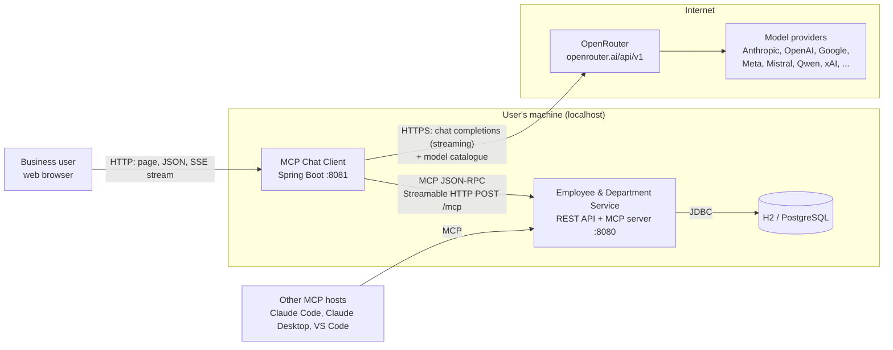

| Actor / system | Role |
|---|---|
| Business user | Chats in the browser and picks the model |
| MCP Chat Client | MCP **host + client**: owns the conversation, the tool-calling loop and the UI |
| OpenRouter | One API key and one OpenAI-compatible endpoint in front of many model providers |
| Employee & Department MCP server | Publishes 14 tools; the only component that touches the database |

The LLM never talks to the MCP server. It only returns *tool call requests*; the chat client executes them through its
MCP client and sends the results back to the LLM.

---

## 3. Key architectural decisions

| # | Decision | Chosen option | Alternatives considered | Rationale |
|---|---|---|---|---|
| ADR-01 | Separate deployable | **Own repo and JVM**, talks to the server only through MCP | Embed chat in the MCP server | Keeps the server a reusable MCP endpoint for any host; the client can point at any MCP server by URL. |
| ADR-02 | LLM access | **OpenRouter via Spring AI's OpenAI starter** (`base-url: https://openrouter.ai/api/v1`) | One provider SDK (e.g. Anthropic only) | One key, hundreds of models, user can switch per message. OpenRouter speaks the OpenAI Chat Completions protocol, so no custom code is needed. |
| ADR-03 | Orchestration | **Spring AI `ChatClient`** with advisors and tool callbacks | Hand-written tool-call loop | Spring AI runs the loop: send tools → receive `tool_calls` → execute → resend, in both blocking and streaming modes. |
| ADR-04 | MCP transport | **Streamable HTTP, SYNC client** | SSE, STDIO, ASYNC client | Matches the server's default transport; sync matches the server's blocking JPA design. |
| ADR-05 | Tool exposure | **All MCP tools on every request** through `SyncMcpToolCallbackProvider` | Hand-picked tool subset | 14 tools is small; the model chooses. Tool discovery happens once at startup. |
| ADR-06 | Model catalogue | **Live OpenRouter list filtered by `supported_parameters=tools`**, cached 1 h, `:batch` variants removed | Hard-coded list | Always current; models without tool support would fail as soon as MCP tools are attached. |
| ADR-07 | Model choice | **Per request** via `OpenAiChatOptions.model(...)`, validated against the catalogue | Fixed in config | Users can compare models mid-conversation; validation stops arbitrary ids. |
| ADR-08 | Streaming | **Server-Sent Events** from `Flux<ServerSentEvent<StreamChunk>>`, each chunk JSON-encoded | WebSocket, raw text stream | One-way stream fits; JSON keeps newlines and leading spaces intact; typed events (`model`, `delta`, `done`, `error`). |
| ADR-09 | Memory | **`MessageWindowChatMemory` (last 20 messages) in memory**, keyed by `conversationId` | JDBC chat memory | Demo scope; swap the repository bean for persistence. |
| ADR-10 | UI | **Single static `index.html`**, no build step | React/Vite SPA | Zero tooling; served by Spring Boot; LLM output sanitised with DOMPurify. |
| ADR-11 | Exposure | **Bind to 127.0.0.1**, no auth | Login | The API spends the owner's OpenRouter credits; local-only until auth is added. |

---

## 4. Container / deployment view

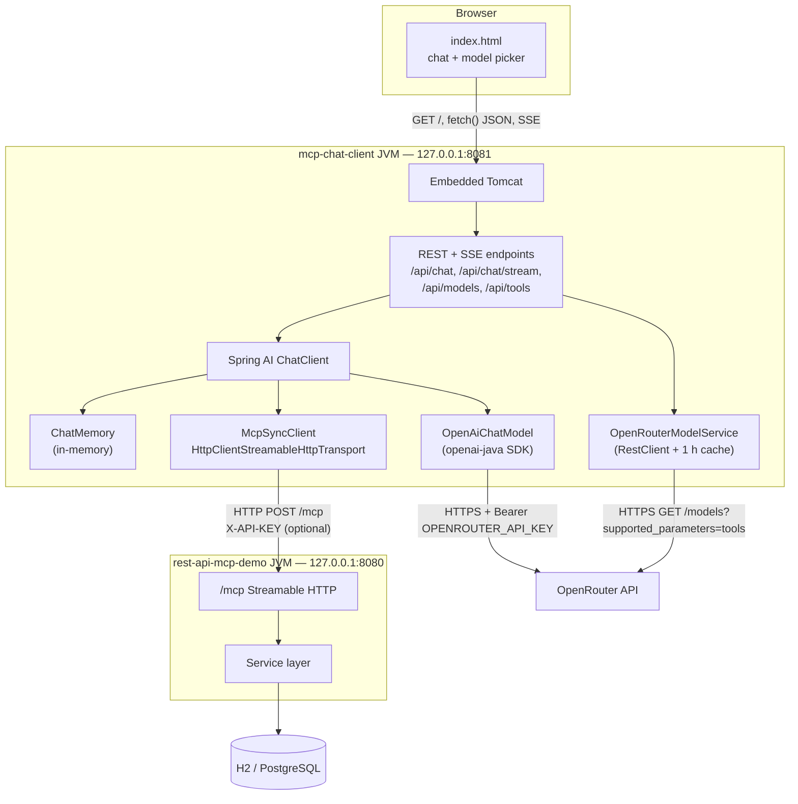

| Process | Port | Start command | Depends on |
|---|---|---|---|
| MCP server (`RestAPIMCPDemo`) | 8080 | `./mvnw spring-boot:run` | Database (H2 in-memory by default) |
| Chat client (`mcp-chat-client`) | 8081 | `OPENROUTER_API_KEY=... ./mvnw spring-boot:run` | MCP server **must be up first** (tools are loaded at startup), OpenRouter |

---

## 5. Component view

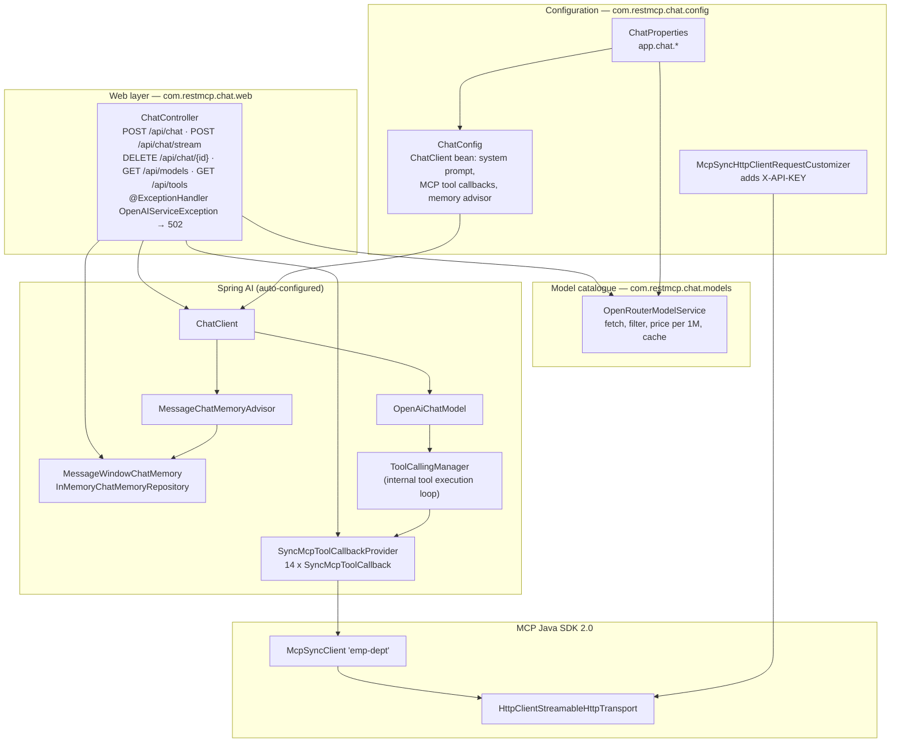

**Rule:** the client contains no HR business rules. Everything about employees and departments, including validation
and confirmation-worthy operations, lives in the MCP server. The client adds only conversation state, model choice and
presentation.

### 5.1 Source layout

```
mcp-chat-client/
├── pom.xml                                   Boot 4.1.1, Spring AI BOM 2.0.1
├── src/main/java/com/restmcp/chat/
│   ├── McpChatClientApplication.java         @SpringBootApplication + @ConfigurationPropertiesScan
│   ├── config/
│   │   ├── ChatConfig.java                   ChatClient bean, system prompt, MCP API-key customizer
│   │   └── ChatProperties.java               app.chat.* (default model, catalogue URL, cache TTL, MCP key)
│   ├── models/
│   │   └── OpenRouterModelService.java       catalogue fetch / filter / cache, model validation
│   └── web/
│       └── ChatController.java               REST + SSE endpoints, error mapping
├── src/main/resources/
│   ├── application.yml                       OpenRouter, MCP connection, timeouts
│   └── static/index.html                     chat UI + model picker
└── docs/architecture/                        this document (Markdown + PDF)
```

---

## 6. Class model

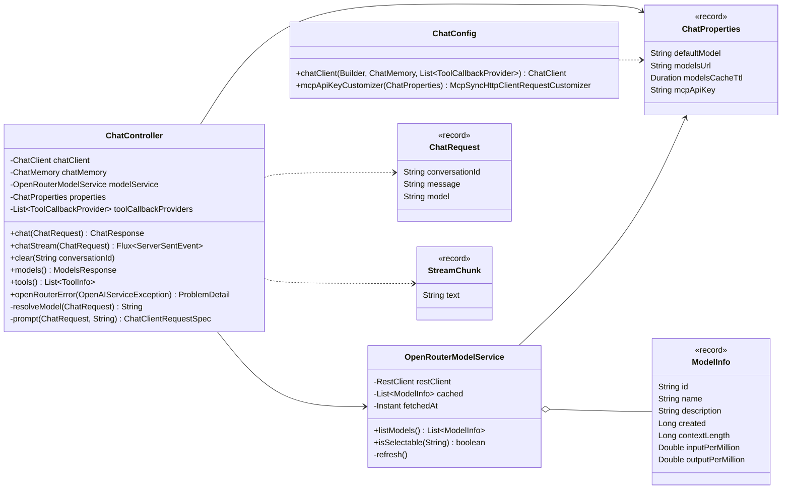

---

## 7. Runtime behaviour

### 7.1 Startup: connecting to the MCP server

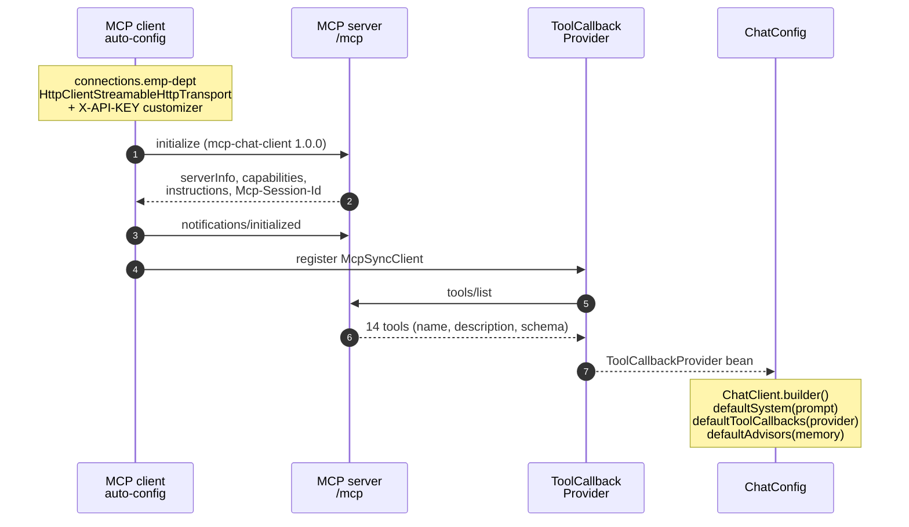

If the MCP server is down, `initialize` fails and the client does not start (`spring.ai.mcp.client.initialized=true`).

### 7.2 Streaming chat with tool calls

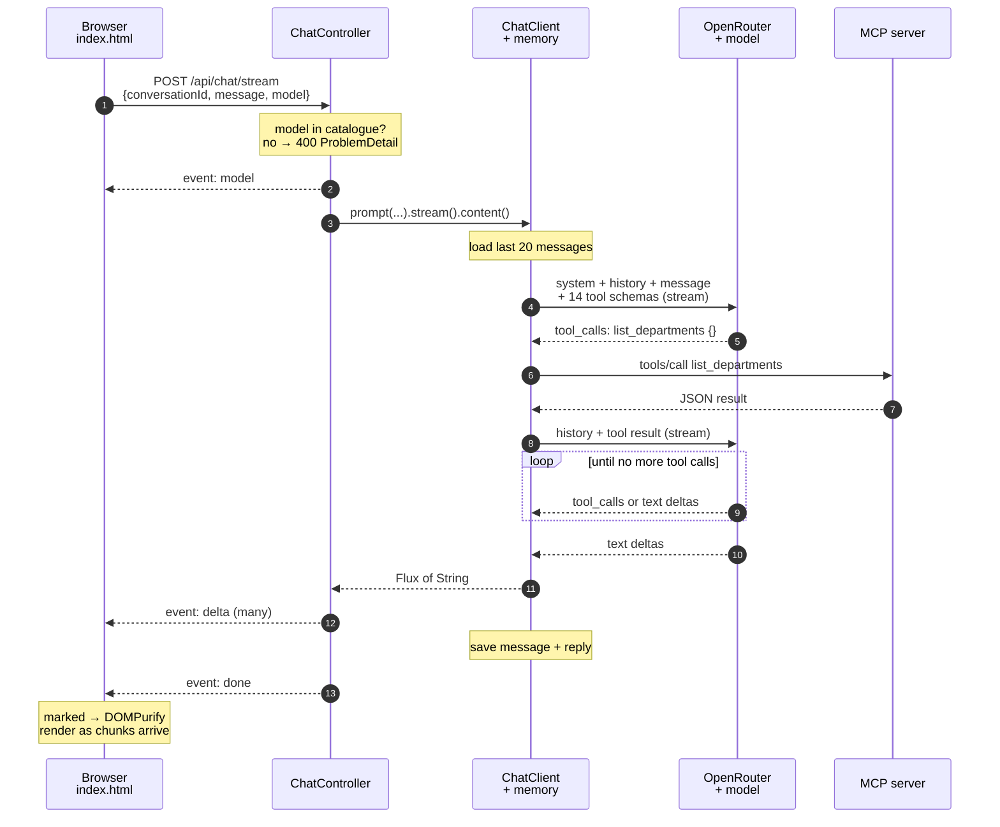

Inside "ChatClient + memory": `MessageChatMemoryAdvisor` loads and saves history, `OpenAiChatModel` calls OpenRouter,
`ToolCallingManager` runs the tool loop, and each call goes through a `SyncMcpToolCallback` → `McpSyncClient` →
`HttpClientStreamableHttpTransport`. Tool calls and tool results are exchanged between the client and the model only;
the browser sees the final text.

### 7.3 Model catalogue

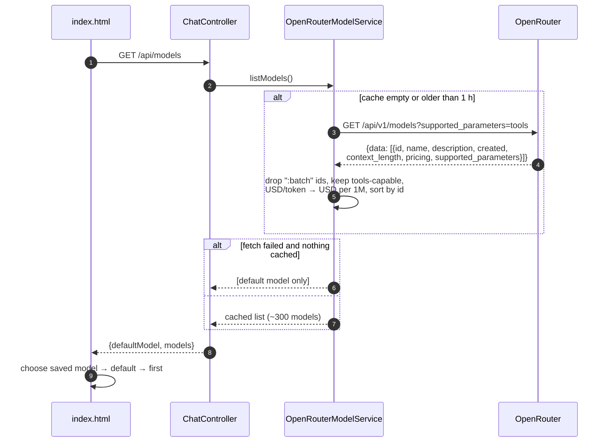

### 7.4 SSE stream format

```text
event:model
data:{"text":"anthropic/claude-opus-5.5"}

event:delta
data:{"text":"**Engineering** has the most"}

event:delta
data:{"text":" employees, with **4** people."}

event:done
data:{"text":""}
```

| Event | When | UI action |
|---|---|---|
| `model` | First, before the LLM is called | Label the reply bubble with the model name |
| `delta` | Each text chunk from the model | Append, re-render markdown |
| `done` | Stream completed | Remove the typing cursor |
| `error` | Upstream failure after the stream started | Show a red error bubble |

### 7.5 Error handling

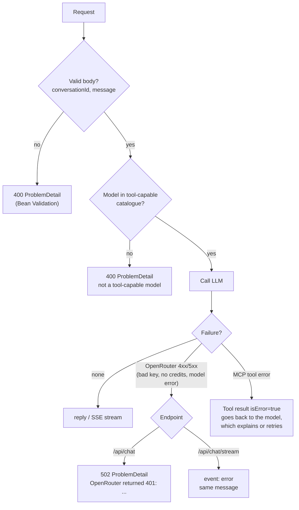

---

## 8. API

| Method | Path | Request | Response |
|---|---|---|---|
| POST | `/api/chat` | `{"conversationId","message","model"?}` | `{"model","reply"}` |
| POST | `/api/chat/stream` | same | `text/event-stream` (§7.4) |
| DELETE | `/api/chat/{conversationId}` | — | 204, memory cleared |
| GET | `/api/models` | — | `{"defaultModel","models":[ModelInfo]}` |
| GET | `/api/tools` | — | `[{"name","description"}]` from the MCP server |
| GET | `/` | — | Chat UI |

Limits: `conversationId` ≤ 100 chars, `message` ≤ 8000 chars. Omitting `model` uses `app.chat.default-model`.

---

## 9. User interface

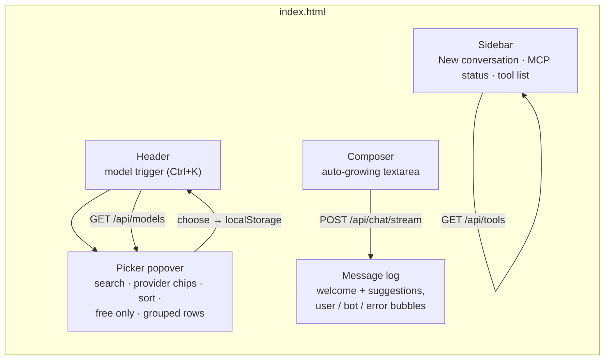

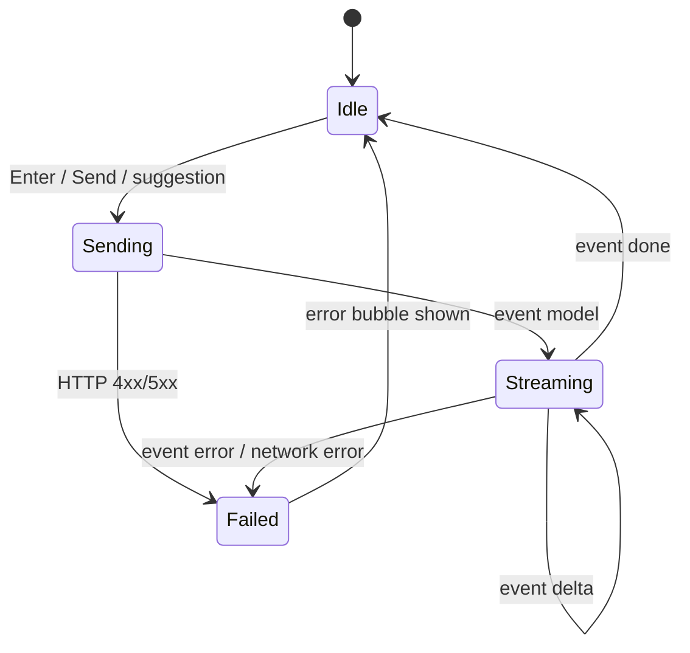

| Picker feature | Detail |
|---|---|
| Search | Multi-word, matches id and display name |
| Provider chips | Built from the catalogue, ordered by model count |
| Sort | Provider (grouped, sticky headers) · Newest · Price low→high · Context largest |
| Badges | Context window (e.g. `1M`), USD per 1M input/output tokens, `Free` |
| Keyboard | Ctrl+K open, ↑/↓ move, Enter choose, Esc close |
| Persistence | Last choice in `localStorage` (wrapped in try/catch) |

LLM output is rendered with `marked` and sanitised with `DOMPurify`; all catalogue and tool text is inserted with
`textContent`.

---

## 10. Configuration

```yaml
server:
  port: ${SERVER_PORT:8081}
  address: ${SERVER_ADDRESS:127.0.0.1}
spring:
  mvc.async.request-timeout: 5m          # long streams with several tool calls
  ai:
    openai:
      base-url: https://openrouter.ai/api/v1
      api-key: ${OPENROUTER_API_KEY}
      chat.options.model: ${app.chat.default-model}
    mcp.client:
      type: SYNC
      request-timeout: 30s
      streamable-http.connections.emp-dept:
        url: ${MCP_SERVER_URL:http://localhost:8080}
        endpoint: /mcp
app.chat:
  default-model: ${OPENROUTER_DEFAULT_MODEL:anthropic/claude-opus-5.5}
  models-url: https://openrouter.ai/api/v1/models?supported_parameters=tools
  models-cache-ttl: 1h
  mcp-api-key: ${MCP_API_KEY:}
```

| Environment variable | Default | Purpose |
|---|---|---|
| `OPENROUTER_API_KEY` | required | OpenRouter key (never committed) |
| `OPENROUTER_DEFAULT_MODEL` | `anthropic/claude-opus-5.5` | Pre-selected model |
| `MCP_SERVER_URL` | `http://localhost:8080` | MCP server base URL |
| `MCP_API_KEY` | empty | Sent as `X-API-KEY`; must equal the server's `APP_API_KEY` |
| `SERVER_PORT` / `SERVER_ADDRESS` | `8081` / `127.0.0.1` | Bind address of the chat client |

---

## 11. Security

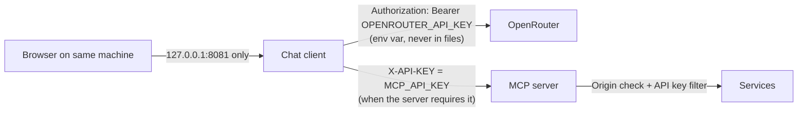

| Concern | Control |
|---|---|
| Secret handling | Keys come from environment variables; `application.yml` only has placeholders |
| Unauthenticated chat API | Bound to `127.0.0.1`; add Spring Security before exposing it |
| Cost control | Only catalogue models accepted; prices shown before choosing |
| Prompt injection via tool results | Model output is sanitised before rendering; destructive tools require user confirmation per the system prompt and the server's tool descriptions |
| Destructive operations | System prompt: describe the change and wait for confirmation before `delete_*` or `transfer_employee` |
| XSS | DOMPurify on rendered markdown; `textContent` for all other dynamic text |
| MCP DNS rebinding | Java `HttpClient` sends no `Origin`, so the server's Origin filter allows it |

---

## 12. Cross-cutting concerns

| Concern | Approach |
|---|---|
| Timeouts | MCP request 30 s; MVC async 5 min for streams; OpenRouter SDK defaults |
| Memory | 20-message window per conversation, in-memory; lost on restart |
| Concurrency | Catalogue refresh is `synchronized`, list is `volatile`; ChatClient and MCP client are thread-safe |
| Observability | Logs only (catalogue fetch failures at WARN, upstream errors at ERROR). Add `spring-boot-starter-actuator` to export Spring AI's chat and tool observations as Micrometer metrics |
| Performance notes | First token waits for model thinking plus each tool round-trip; Opus-class models send larger chunks than Haiku-class |

---

## 13. Limitations and next steps

| Limitation | Possible next step |
|---|---|
| No authentication on the chat API | Spring Security (form login or OAuth2) and per-user conversations |
| Memory lost on restart | `JdbcChatMemoryRepository` |
| Client fails to start if the MCP server is down | Lazy MCP initialisation with retry, and a "reconnect" action |
| Tool calls invisible in the UI | Stream tool-call events (name, arguments, duration) as an extra SSE event type |
| No stop button | Cancel the `fetch` reader and dispose the server `Flux` |
| Tools only | Add MCP resources (`org://departments`) and prompts (`department_report`) to the UI |

---

## 14. Run book

```powershell
# 1. MCP server
cd RestAPIMCPDemo
./mvnw spring-boot:run

# 2. Chat client
cd mcp-chat-client
$env:OPENROUTER_API_KEY = "sk-or-..."
./mvnw spring-boot:run

# 3. Open http://localhost:8081
```

Smoke checks: `GET /api/tools` returns 14 tools; `GET /api/models` returns roughly 300 models; asking
"Which department has the most employees?" streams an answer naming Engineering (4 employees) with the seed data.
